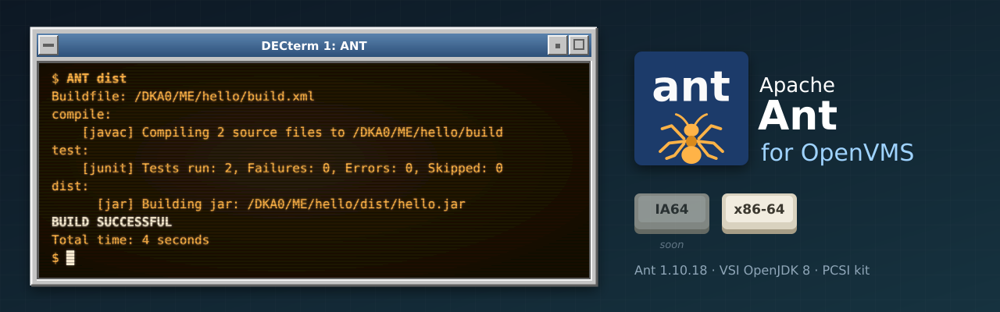

<p align="center">
  
</p>

# Apache Ant for OpenVMS


[](LICENSE)

[Apache Ant](https://ant.apache.org) (**1.10.18**) for OpenVMS on **x86-64**
(IA64 to follow), running on VSI OpenJDK 8. It belongs to the same family as
[Apache Maven](https://github.com/issinoho/vms-maven), [GNU grep](https://github.com/issinoho/vms-grep),
[curl](https://github.com/issinoho/vms-curl) and the other
[vms-* ports](https://openvms.issinoho.com).

Ant is Java and already has OpenVMS code (an `openvms` OS family, a DCL command
launcher), but that code was written for HP's Java and no longer works with VSI's. This
repository holds **only our changes** over the signed upstream binary distribution:

- **`ANT.EXE`**, a launcher that does what `bin/ant` does (Ant home, Java, `ANT_OPTS`,
  `ANT_ARGS`, `CLASSPATH`, `-lib`, `~/.ant/lib`). It is an image rather than a DCL
  procedure, so targets and `-D` options keep their case and there is no limit of eight
  parameters.
- **`ANTDCL.EXE`**, which runs the DCL commands a build starts: VSI's JVM starts DCL
  procedures unreliably and loses their line ends (docs/NOTES.md N8, N9).
- **Six patched classes** in `lib/ant.jar`, compiled on the node from the signed source
  distribution. Each is guarded by `Os.isFamily("openvms")` so it can go upstream.

**Status:** [v1.10.18-vms1](https://github.com/issinoho/vms-ant/releases/tag/v1.10.18-vms1)
for x86-64. The IA64 kit will follow (docs/PLAN.md).

## Using it

From the kit (`tools/kit.sh`):

```dcl
$ PRODUCT INSTALL ANT /PRODUCER=ISSINOHO /SOURCE=<directory with the kit>
$ @ANT$ROOT:[000000]ANT$SETUP.COM        ! defines ANT; sets up Java if needed
$ SET PROCESS/PARSE_STYLE=EXTENDED       ! keep the case of arguments
$ PIPE ANT -f /DISK$USER/ME/proj/build.xml dist > build.log
```

`ANT$STARTUP.COM` (in `SYS$STARTUP`) defines `ANT$ROOT` at boot; the kit's `README.VMS`
has the rest. VSI ships an ANT kit of its own (1.10.14, `ANT$HOME`); the two install side
by side, so give PRODUCT commands `/PRODUCER=ISSINOHO`.

- Under the TRADITIONAL parse style (the default, and what batch jobs get), arguments not
  in quotes reach Ant in lower case. The launcher prints a note when Ant then fails.
- Give file options Unix paths; paths in build files are Unix paths too.
- **Forked programs:** `<java fork>`, `<javac fork>`, `<junit fork>`, `<junitlauncher>`
  and `<javadoc>` run the JDK's images (`JAVA.EXE`, `JAVAC.EXE`...) with their arguments
  as given. A program's exit code decides success, as on other systems.
- **DCL:** `<exec executable="mms">` runs a DCL command when no image of that name exists,
  so DCL verbs and foreign-command symbols work; `vmlauncher="false"` always uses DCL,
  `vmlauncher="true"` never does. A DCL command's success status counts as exit code 0.
- `<property environment="env"/>` gives the process's logical names (`env.SYS$LOGIN`).
- **File versions:** the launcher has Java delete and rename all versions of a file, so
  `<delete>` and clean targets work. Files a build rewrites in place (JUnit reports,
  `<echo file>`) still get new versions.
- **Quotas:** Java wants FILLM 4096 and PGFLQUOTA 2097152; forked JVMs share them with
  Ant's, so larger builds need them. `ANT_OPTS` sets the JVM's sizes.
- **On a terminal:** CTRL/C and CTRL/Y stop Ant cleanly, also while a DCL command runs.
  `$STATUS` afterwards is not reliable.
- `ANT_VMS_TRACE` prints the Java command and each DCL command `ANTDCL.EXE` runs.

## Patches

| Patch | What | Why |
|---|---|---|
| 0001 | JavaEnvUtils: `<tool>.exe` on OpenVMS | every fork ran a bare `java`, which cannot be run (NOTES N4) |
| 0002 | forked java and javac: arguments on the command line, not a `-V` file | VSI's JVM splits each line of the `-V` file at spaces (N5, N7) |
| 0003 | Execute.isFailure: non-zero is failure | VSI's JVM returns Unix exit codes; the old even-is-failure rule failed good runs (N5) |
| 0004 | VmsCommandLauncher: paths, quoting, exit status, ANTDCL | DCL got Unix paths and broken quoting; procedures fail to start from Java (N6, N8) |
| 0005 | Execute: read SHOW LOGICAL output | `<property environment>` was empty (N6) |
| 0006 | `<exec>`: DCL fallback for a bare name | `mms`, `dir` and DCL symbols are not images (N10) |

## Building

```sh
tools/prepare.sh                 # fetch + verify, unpack, patch -> staging/
tools/build.sh <ia64|x86>        # ANT.EXE, ANTDCL.EXE and the patched ant.jar, on the node
tools/test.sh <node> [suite]     # batch job: smoke (default), projects
tools/ttytest.sh <node>          # ANT on a terminal: output, CTRL/C, CTRL/Y
tools/kit.sh <node>              # build, then the PCSI kit -> out/kits/
tools/installcheck.sh <node>     # install the kit, smoke-test it, remove it
```

ttytest.sh needs pexpect and pyte on the build host (`python3 -m venv cache/venv;
cache/venv/bin/pip install pexpect pyte`, or set `TTYTEST_PYTHON`).

`tools/nodes.conf` (from `nodes.conf.example`) names the nodes. Builds need VSI C and VSI
OpenJDK 8 on the node; nothing Java is compiled on the build host.

## Artwork

`docs/images/banner.svg` was made for this project in the style of classic DECwindows and
VT terminals, like those of its sibling ports. The "ant" mark in it is our own drawing, not
Apache Ant's logo.

## Licence

Ant is under the Apache License 2.0 (`LICENSE` and `NOTICE` in the distribution); our
files are under the same licence.
